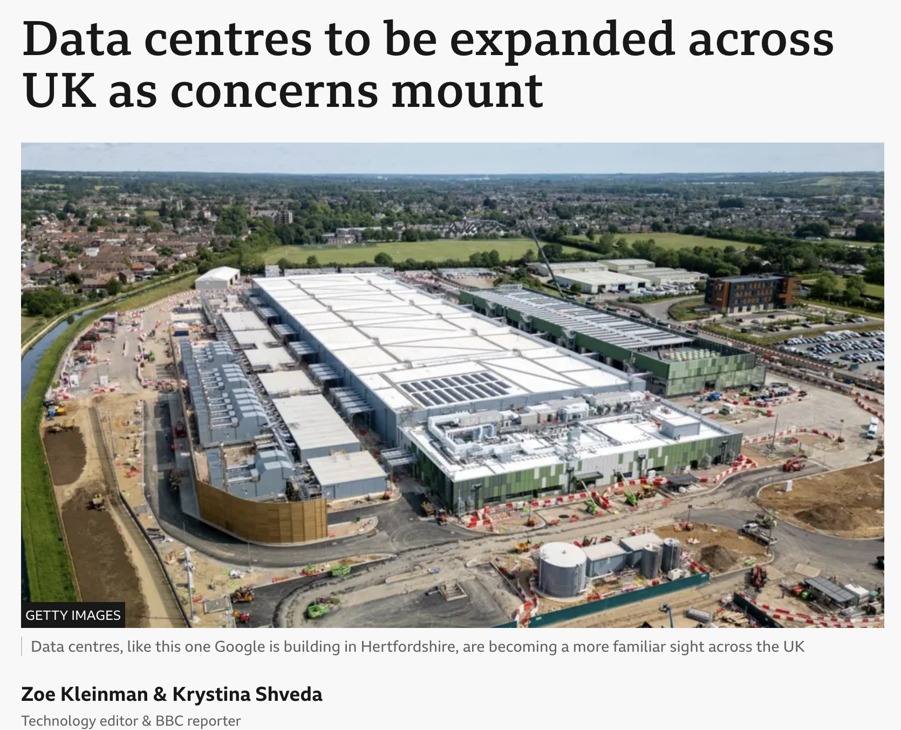
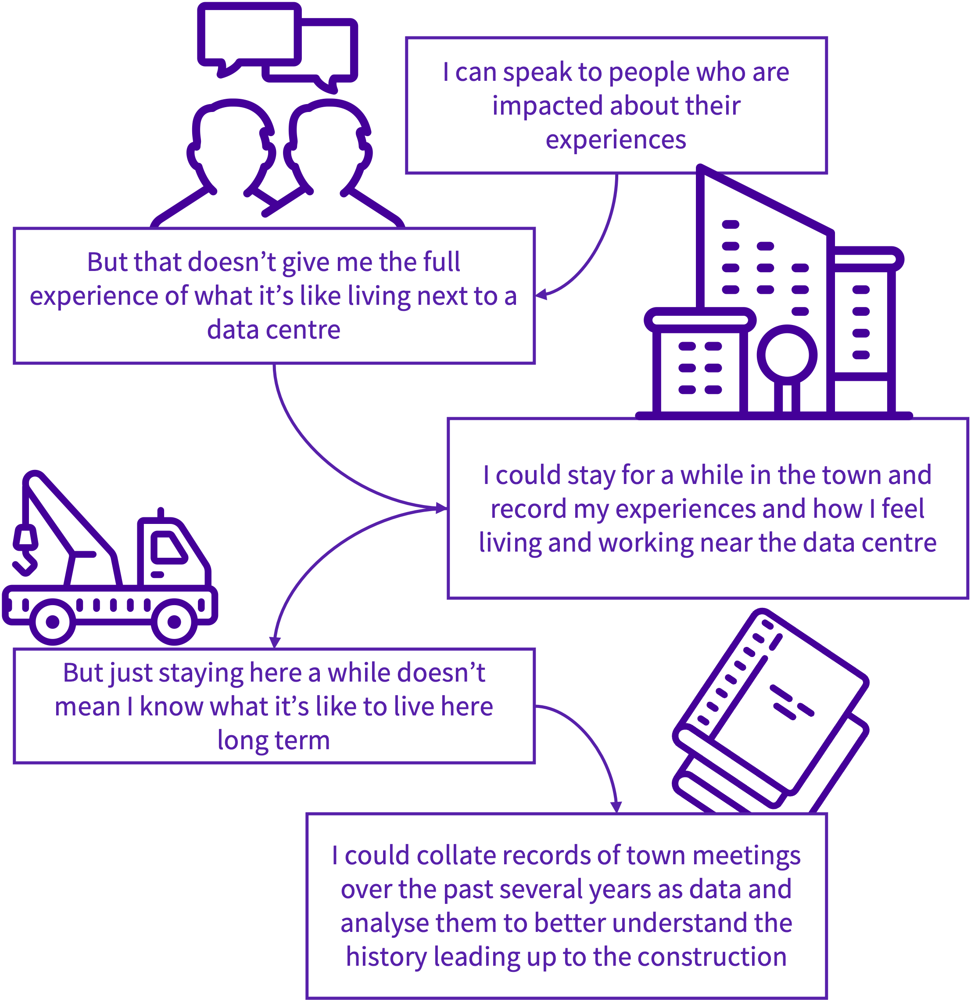
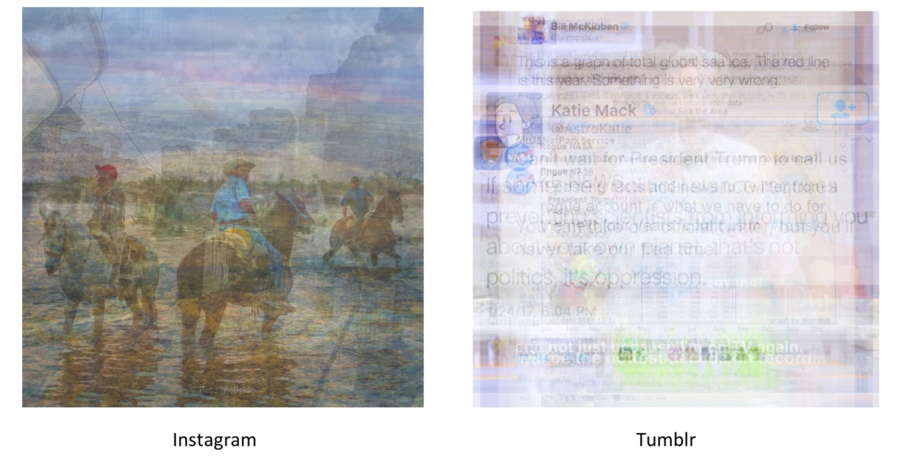

class: middle, title
background-size: contain

<!----- Make a pdf using:

decktape generic --key=ArrowRight --load-pause 1800 --slides '1-53' --size '1216x684' --url-load-timeout 80000 --page-load-timeout 40000 "week-05/slides/smi105-week-5.html" week-05/slides/smi105-week-5.pdf

----->


<br><br>

# Social Research Methods
#### EDC117: Week 6

<br><br>

**Dr. Calum Webb**<br>
Sheffield Methods Institute, the University of Sheffield<br>
[c.j.webb@sheffield.ac.uk](mailto:c.j.webb@sheffield.ac.uk)

```{r setup, include=FALSE}
options(htmltools.dir.version = FALSE)

# These packages are required for creating the slides
# Many will need to be installed from Github
library(icons)
library(tidyverse)
library(xaringan)
library(xaringanExtra)
library(xaringanthemer)

# Defaults for code
knitr::opts_chunk$set(
  fig.width=9, fig.height=3.5, fig.retina=3,
  out.width = "100%",
  cache = FALSE,
  echo = TRUE,
  message = FALSE, 
  warning = FALSE,
  fig.show = TRUE,
  hiline = TRUE
)

# set global theme for ggplot to make background #F8F8F8F8 (off white),
# but otherwise keep all ggplot themes default (better for teaching)
theme_set(
  theme(plot.background = element_rect(fill = "#F8F8F8", colour = "#F8F8F8"), 
        panel.background = element_rect(fill = "#F8F8F8", colour = "#F8F8F8"),
        legend.background = element_rect(fill = "#F8F8F8", colour = "#F8F8F8")
        )
  )

```

```{r xaringan-tile-view, echo=FALSE}
# Use tile overview by hitting the o key when presenting
xaringanExtra::use_tile_view()
```

```{r xaringan-logo, echo=FALSE}
# Add logo to top right
xaringanExtra::use_logo(
  image_url = "header/smi-logo-white.png",
  exclude_class = c("inverse", "hide_logo"), 
  width = "180px", position = css_position(top = "1em", right = "2em")
)
```

```{r xaringan-themer, include=FALSE, warning=FALSE}

# Set some global objects containing the colours
# of the university's branding
primary_color <- "#131E29"
secondary_color <- "#440099"
tuos_blue <- "#9ADBE8"
white = "#F8F8F8"
tuos_yellow <- "#FCF281"
tuos_purple <- "#440099"
tuos_red <- "#E7004C"
tuos_midnight <- "#131E29"

# The bulk of the styling is handled by xaringanthemer
style_uos <- style_duo_accent(
  primary_color = "#131E29",
  secondary_color = "#440099",
  colors = c(tuos_purple = "#440099", 
             grey = "#131E2960", 
             tuos_blue ="#9ADBE8",
             tuos_mint = "#00CE7C",
             ac_yellow = '#FEC740'),
  header_font_google = xaringanthemer::google_font("Source Serif Pro", "600", "600i"),
  text_font_google   = xaringanthemer::google_font("Source Sans Pro", "300", "300i", "600", "600i"),
  code_font_google   = xaringanthemer::google_font("Lucida Console"),
  header_h1_font_size = "2rem",
  header_h2_font_size = "1.5rem", 
  header_h3_font_size = "1.25rem", 
  text_font_size = "0.9rem",
  code_font_size = "0.65rem", 
  code_inline_font_size = "0.85rem",
  inverse_text_color = "#9ADBE8", 
  background_color = "#F8F8F8", 
  text_color = "#131E29", 
  link_color = "#005A8F", 
  inverse_link_color = "#F8F8F8",
  text_slide_number_color = "#44009970",
  table_row_even_background_color = "transparent", 
  table_border_color = "#44009970",
  text_bold_font_weight = 600
)

style_uos

```


```{r xaringan-panelset, echo=FALSE}
# Allow for adding panelsets (see example on slide 2)
xaringanExtra::use_panelset()
```

```{r xaringanExtra, echo = FALSE}
# Adds white progress bar to top
xaringanExtra::use_progress_bar(color = "#F8F8F8", location = "top")
```

```{r xaringan-extra-styles, echo = FALSE}
# Allow for code to be highlighted on hover
xaringanExtra::use_extra_styles(
  hover_code_line = TRUE,         #<<
  mute_unhighlighted_code = TRUE  #<<
)
```

```{r share-again, echo=FALSE}
# Add sharing links and other embedding tools
xaringanExtra::use_share_again()
```

```{r xaringanExtra-search, echo=FALSE}
# Add magnifying glass search function to bottom left for quick
# searching of slides
xaringanExtra::use_search(show_icon = TRUE, auto_search = FALSE)
```

---

class: middle, inverse

# Sign in

---

class: middle

## Learning outcomes

.panelset[

.panel[.panel-name[What will I learn?]

By the end of this week you will know:

* How data is systematically collected by social researchers according to different aims and the paradigms of quantitative and qualitative social research.

* What kinds of methods are typical in quantitative and qualitative research, and how do researchers ensure they are being ethical when they conduct research.

* How can data visualisation fit into qualitative and quantitative approaches to social research

* How can we process qualitative data in R in a way that we can quantify and visualise topics and sentiments.

]
]

---

class: inverse, middle

#### Part I

# Where does our data come from? Introduction to Social Research Methods


---

.pull-left[

<br><br><br><br><br><br>

## Quantitative Research

Quantitative research describes an approach where researchers find ways to quantify what they are interested in through operationalisation of concepts, so that statistical methods can be used to identify patterns, test hypotheses, and establish the size and scale of the topic concerned. It is typically *deductive* in its approach, the researcher starts with an idea, develops a way to test it, collects data, and then performs their analysis and publishes their results.

.footnote[Bryman, Alan (2012). Social research methods (4th ed.). Oxford: Oxford University Press.]

]

--

.pull-right[

<br><br><br><br><br><br>

## Qualitative Research

Qualitative research describes an approach that is associated with research that involves in-depth engagement with the phenomena of interest and the systematic collection and analysis of large quantities of unstructured data in the form of text, case studies, conversations, records of experiences and social interactions, historical accounts, and so on, in order to develop rich descriptions and 'make sense of' things through the meanings people give to them. 


.footnote[Denzin NK, Lincoln YS, editors. The Sage handbook of qualitative research. Thousand Oaks: SAGE Publications; 2005]

]

---

.pull-left[

<br><br><br><br>

## Same topic, different approaches...

How might we approach the same problem in different ways in a quantitative versus qualitative approach? We'll use a case study example throughout the lecture based on the following research question:

> In what ways might the proliferation of data centres impact society?


]

.pull-right[

<br><br>

```{r, echo=FALSE, fig.alt="A data centre in Heretfordshire", fig.cap="Source: <a href='https://www.bbc.co.uk/news/articles/clyr9nx0jrzo' target='_blank'>BBC News. (2025).</a>"}



```


]


---

.pull-left[

<br><br><br><br>

## Same topic, different approaches...

How might we approach the same problem in different ways in a quantitative versus qualitative approach? We'll use a case study example throughout the lecture based on the following research question:

> In what ways might the proliferation of data centres impact society?


]

.pull-right[

<br><br><br>

## A quantitative approach...

In what ways can we measure data centres and their proliferation? 

```{r, echo = FALSE}

knitr::kable(tribble(
  ~`Measuring Data Centres`, 
  "Number of Data Centres",
  "Square footage of data centres",
  "Amount of social media posts online",
  "Number of planning applications for data centres",
  "Power usage of data centres"
))

```


]

---

.pull-left[

<br><br><br><br>

## Same topic, different approaches...

How might we approach the same problem in different ways in a quantitative versus qualitative approach? We'll use a case study example throughout the lecture based on the following research question:

> In what ways might the proliferation of data centres impact society?


]

.pull-right[

<br><br><br>

## A quantitative approach...

How about impact on society? How might we quantify and measure that? 

```{r, echo = FALSE}

knitr::kable(tribble(
  ~`Measuring Impact on Society`, 
  "Economic impact of data centres",
  "Ecological impact of data centres (water quality, noise levels)",
  "Concurrence with poverty rates, job losses or growth",
  "Whether social media posts are positive or negative",
  "House prices near data centres",
  "Numbers of rallies and protests against data centre construction"
))

```


]

---

.pull-left[

<br><br><br><br>

## Same topic, different approaches...

How might we approach the same problem in different ways in a quantitative versus qualitative approach? We'll use a case study example throughout the lecture based on the following research question:

> In what ways might the proliferation of data centres impact society?


]

.pull-right[

<br><br><br>

## A quantitative approach...

If we collect data on these things, what kinds of hypotheses could we test and what would this tell us about the topic?

* Is there an association between the number of data centres built and the existing poverty rate? Are communities with high rates of poverty more likely to have data centres imposed on them?
* Do towns where a data centre has been built see a decrease in their rates of unemployment five years after construction, compared to towns with comparable starting levels of unemployment that did not have data centres constructed?
* As data centres have become more frequently talked about, has the average attitudes towards them become more negative or more positive on social media?


]

---


.pull-left[

<br><br><br><br>

## Same topic, different approaches...

How might we approach the same problem in different ways in a quantitative versus qualitative approach? We'll use a case study example throughout the lecture based on the following research question:

> In what ways might the proliferation of data centres impact society?


]

.pull-right[

<br><br>

## A qualitative approach

A qualitative approach may emphasise *induction*, rather than deduction. In other words, a qualitative approach may start by thinking about questions like:

* What are my own experiences of and attitudes towards data centres? Where are my blind spots?
* How can I access people who make decisions regarding data centres, their locations, their impact and regulation?
* How can I access people who are affected by their construction? Where do I need to be?
* How might what I hear or observe be different depending on the way that I approach the research? 
* How much time can I realistically spend in the field (not a literal one) gathering data?

]

---

.pull-left[

<br><br><br><br>

## Same topic, different approaches...

How might we approach the same problem in different ways in a quantitative versus qualitative approach? We'll use a case study example throughout the lecture based on the following research question:

> In what ways might the proliferation of data centres impact society?


]

.pull-right[

<br>

## A qualitative approach

```{r, echo = FALSE, fig.alt="A flowchart of a qualitative research planning thought process that goes: 'I can speak to people who are impacted about their experiences', 'But that doesn’t give me the full experience of what it’s like living next to a data centre', 'I could stay for a while in the town and record my experiences and how I feel living and working near the data centre', 'But just staying here a while doesn’t mean I know what it’s like to live here long term', 'I could collate records of town meetings over the past several years as data and analyse them to better understand the history leading up to the construction'", out.width="70%", fig.align='center'}



```

We might then think about how we could undertake our research in a way that maximises the richness of our data.

]


---

.pull-left[

<br><br><br><br>

## Same topic, different approaches...

How might we approach the same problem in different ways in a quantitative versus qualitative approach? We'll use a case study example throughout the lecture based on the following research question:

> In what ways might the proliferation of data centres impact society?


]

.pull-right[

<br><br>

## A qualitative approach

Once this data has been collected, there needs to be a systematic approach to analysing it in a way that helps us identify and construct themes that help us (and the audience for our research) understand the topic. This is typically called the 'coding' of the data, and there are many different approaches.

* Are there similar themes that come up often through what people say, do, and the contexts surrounding them?
* Are there wider narratives and are these the same for everyone I spoke to? Are they consistent with my own experiences or the data that wasn't based on my presence? Did different people attach different meanings to the same events? Why might this be?
* Can some of the subjects of my data serve as informative case studies for how people think about and react to the building of data centres?

]


---

.pull-left[

<br>

## Typical Methods in Quantitative Research

* **Surveys** (closed questions) distributed to representative samples of a wider population (e.g. voters).
* **Observation** (counting occurrences or gathering data on what is 'left behind' via unobtrusive methods) can be by the researcher, or by sensors/other means, e.g. traffic violations/near misses, time spent interacting with an exhibit, smart-watch data on biometrics, social media posts, etc.
* **Secondary data analysis of administrative data** (data that is collected for some other purpose, but can be valuable for research) — rates of people receiving unemployment-related benefits, school attendance rates, etc.
* **Experiments and quasi-experimental designs** (manipulating something of interest in a treatment group, and comparing to a control group), e.g. A.B. testing in social media such as Youtube video thumbnails and measuring click-through.


]

.pull-right[

<br>

```{r, echo = FALSE, fig.alt="A screenshot of the Yougov App main page", out.width="45%", fig.align='center', fig.cap="YouGov, a Major Survey Company"}


```

]

---

.pull-left[

<br>

```{r, echo = FALSE, fig.alt="Image of someone taking fieldnotes", out.width="70%", fig.align='center', fig.cap="Photo by Stephen Astu, Unsplash"}


```

]

.pull-right[

<br>

## Typical Methods in Qualitative Research

* **Surveys** (open questions) free-text responses that allow participants to answer in whatever way they want in writing.
* **Interviews and focus groups**, asking people directly about the topic and allowing rich narratives to be developed through dialogue.
* **Ethnography/Observation** recording what happens in the field (including online spaces), what was said, and the researchers' own experiences/feelings about what is happening.
* **Diary methods** (asking participants to record their experiences, thoughts, feelings over time), can be through video, text, photographs, etc.
* **Secondary analysis of text** (text here can also mean video, photographs, etc.) — examples include qualitative data repositories like Qualibank (UK Data Service), document analysis, and so on.


]

---

.pull-left[

<br><br><br>

# Let's do a survey where we have open and closed questions...

* The first question is a **closed** response question because the researcher has decided beforehand that you can only identify as someone who 'lived in Sheffield already' or as someone who 'lived outside of Sheffield' — there is not much room of nuance.

* The remaining questions are **open** response questions because you are able to answer however you like.

We'll use the results to create some plots in the workshop on Thursday.

]

.pull-right[

<br>

```{r, echo=FALSE, out.width=450, out.height=450, fig.width=4.5, fig.height=4.5, fig.align='center', fig.alt='QR Code for an online survey', fig.cap="Our survey: <a href='https://forms.gle/z5kSeGMFG4Yz7HrL8' target='_blank'>https://forms.gle/z5kSeGMFG4Yz7HrL8</a>"}

library(qrcode)
survey_code <- qr_code("https://forms.gle/z5kSeGMFG4Yz7HrL8")
par(bg = white)
plot(survey_code)


```

]

---

# Some Strengths and Weaknesses of Research Design

.pull-left[

### Quantitative Social Research Methods

**What can be easier?**

* *Reliability*: The research design is easier to replicate and apply in different circumstances, with different people, to test whether we find similar things each time.
* *Generalisability*: We can design studies in a way that means our participants are reflective of a wider group we are interested in, and use statistical techniques to account for the impact of sampling variability.
* *Time and cost*

**What can be more challenging?**

* *Validity*: the ways participants can express themselves is limited by the need to restrict responses in ways that can be represented quantitatively (into mutually exclusive groups, or numbered ranges, etc.)

]

--

.pull-right[

### Qualitative Social Research Methods

**What can be easier?**

* *Validity*: Participants are able to express themselves in ways that are authentic to them, through a variety of different mediums, so data is more likely to represent their actual beliefs and feelings about something.
* *Identifying the "how" and "why"*: The flexibility of qualitative methods enables researchers to explore narratives and individual histories to better describe social processes.

**What can be more challenging?**

* *Reliability & generalisation*: The nature of qualitative research (richness of data and number of participants) means it can be difficult to be confident that our findings extent to all instances of the social phenomena.

]


---

.pull-left[

<br>

# Research Ethics

Ethical review ensures that research does not breach peoples' legal and human rights.

* **Anonymity**: The right to respect for private and family life (Article 8 ECHR, GDPR, UK GDPR)
* **Informed consent**: Participants must be informed of the purpose for which the data is being collected so that they can knowingly consent to its collection and use (GDPR, UK GDPR)
* **Right to Withdraw**: When consent is given, participants must be able to freely withdraw that consent to prevent further processing of personally identifying information or their participation (Articles 17 to 19 GDPR)
* **Prevention of harm**: participants should not be subject to harmful, degrading, or inhumane treatment in research, and any risk of harm should be clearly communicated to participants and managed.


]

--

.pull-right[

# &nbsp;

<br>

**Beyond legal requirements**, ethics in research also includes considerations and questions about social responsibility and harm:

* Is our research representative of the diversity of people affected by an issue?
* Are our research methods transparent, well-documented, reproducible, and open for scrutiny and critique?
* When we publish our research, are some groups of people likely to be put at risk of harm than others?
* Are our research methods exploitative of our research participants — is it ethical for me to build my career on the time and contributions of my participants, who may be vulnerable? Can I empower those participants? (see: Participatory research).

]

---

class: inverse, middle

#### Part II

# Data Visualisation in Social Research

---

.pull-left[

<br>

# Data visualisation in social research

**What can our data visualisations add to social research?** 

* The data visualisations we have been making so far come from the **quantitative** side of social research.

* Data visualisations can help **draw attention to an issue** initially, so that people engage with the stories and themes that come from our qualitative reserach.

* Data visualisations can also be used as a form of **elicitation** when conducting qualitative research. We can use them as an *object* to prompt peoples' opinions and thoughts.

]

--

.pull-right[

<br>

```{r, echo = FALSE, out.width=500, out.height=500, fig.width=5, fig.height=5, fig.align='center', fig.alt="A scatterplot showing a slight negative correlation between state GDP per capita and the Data Centre footprint relative to the size of the state. Virginia is shown as an outlier with 288 data centres, compared to the next highest state of Oregon with 91 data centres."}

library(ggbeeswarm)

datcens <- read_csv("data/im3_open_source_data_center_atlas.csv")
us_poverty <- read_csv("data/us_poverty.csv")

#anti_join(datcens, us_poverty, by = c("state"="area"))
datcens <- left_join(datcens, us_poverty, by = c("state"="area"))

state_sizes <- read_csv("data/state_sizes.csv")

#anti_join(datcens, state_sizes, by = "state")
datcens <- left_join(datcens, state_sizes, by = "state")

gdp <- read_csv("data/gdp.csv")
#anti_join(datcens, gdp, by = "state")
datcens <- left_join(datcens, gdp, by = "state")

datcen_plot <- datcens %>%
  drop_na(sqft) %>%
  group_by(state) %>%
  summarise(
    n_datacenters = n(),
    sqkm_datacenters = sum(sqft)*9.290303999E-8,
    poverty_rate = first(percent),
    total_area_km = first(total_area_km),
    sqkm_dc_per_10k = (sqkm_datacenters / total_area_km)*10000,
    gdp_per_capita = first(gdp_per_capita)
  ) %>% 
  # lm(data = ., formula = sqkm_dc_per_10k ~ gdp_per_capita + poverty_rate, weights = n_datacenters) %>% summary()
  filter(n_datacenters > 5) %>%
  ggplot() +
  aes(y = sqkm_dc_per_10k,
      x = gdp_per_capita) +
  geom_beeswarm(cex = 3, aes(size = n_datacenters), colour = tuos_purple) +
  geom_text(aes(label = n_datacenters), colour = white, size = 2) +
  #geom_smooth(se = FALSE, method = "lm") +
  scale_size_continuous(range = c(3, 12)) +
  theme(legend.position = "none") +
  scale_x_continuous(labels = scales::dollar_format()) +
  scale_y_continuous(limits = c(0, 0.9)) +
  annotate(
    "curve",
    colour = tuos_purple,
    x = 94000, xend = 105000,
    y = 0.75, yend = 0.6, curvature = -0.3
  ) +
  annotate("text",
           x = 105000, size = 8*(5/14),
           y = 0.59, vjust = 1, lineheight = 1,
           label = "Virginia has 3x more\ndata centres than the\nstate with the second largest\nnumber of data centres.") +
  ylab("Square km of\nData Centres per\n100,000 km area") +
  xlab("GDP per capita (USD)") +
  theme(axis.title.y = element_text(angle = 0, vjust = 0.7, 
                                    size = 8),
        axis.title.x = element_text(size = 8), 
        plot.caption = element_text(size = 8, hjust = 1),
        plot.title = element_text(size = 16, face = "bold", hjust = 0, margin = margin(b = 4)),
        plot.subtitle = element_text(size = 9, hjust = 0),
        axis.text = element_text(size = 8)) +
  ggtitle("In whose backyard?", subtitle = "US states with at least 5 Data Centres") +
  labs(caption = "\nData from Kendall, et al. (2026). IM3 Open Source Data Center Atlas")

datcen_plot

```

]


---

.pull-left[

<br>

# 'Futuring the Cloud' by Madelyn Zander (2024)

> Research Question: "What are the daily experiences of individuals who live alongside large-scale data center developments?"

* North Virginia
* 56 semi-structured formal interviews (30-90 minutes)
* 63 spontaneous/unplanned interviews (up to 30 minutes in length)
* Ethnography (walking around the area, attending committee meetings, signing up to email groups)
* Document review (reviewing planning applications, laws and byelaws, proceedings, promotional and activist materials, historical accounts, media coverage)

]

.pull-right[

<br>

```{r, echo = FALSE, out.width=500, out.height=500, fig.width=5, fig.height=5, fig.align='center', fig.alt="A scatterplot showing a slight negative correlation between state GDP per capita and the Data Centre footprint relative to the size of the state. Virginia is shown as an outlier with 288 data centres, compared to the next highest state of Oregon with 91 data centres."}

datcen_plot

```

]

---

.pull-left[

<br>

# 'Futuring the Cloud' by Madelyn Zander (2024)

<br>

> "We are selling the town soul for uncertain data center tax revenues;" Alec remarked that "everyone thinks the money will magically appear tomorrow and fix everything, but look at Gainesville [a nearby community], that project was passed two years ago, and the building isn’t even finished." p. 143

&nbsp;

> “I no longer enjoy tending to my garden. It’s like I live next to a busy highway now. We can’t be expected to live like this.” Martha, pp.153-154

]

.pull-right[

<br>

```{r, echo = FALSE, out.width=500, out.height=500, fig.width=5, fig.height=5, fig.align='center', fig.alt="A scatterplot showing a slight negative correlation between state GDP per capita and the Data Centre footprint relative to the size of the state. Virginia is shown as an outlier with 288 data centres, compared to the next highest state of Oregon with 91 data centres."}

datcen_plot

```

]

---

.pull-left[

<br>

# 'Futuring the Cloud' by Madelyn Zander (2024)

"In addition to simply filing noise complaints and noise pollution violations—making their own kind of noise—community members are engaging in what I consider to be an important form of activism and community-based knowledge production—what many environmental justice scholars term “citizen science” (Ottinger, 2010). ... John, the same community member who conducted a financial study of the Digital Gateway, conducted a noise study to challenge the findings of a large corporation. Through their own instruments and analyses, and even by bringing their everyday experiences to the Board, the opposition sought recognition by government officials, for their concerns to be taken seriously enough to influence local policy and regulation of data center noise." (p.157) **Zander (2024) discussing the theme of citizen science that they identified in their qualitative data.**


]

.pull-right[

<br>

```{r, echo = FALSE, out.width=500, out.height=500, fig.width=5, fig.height=5, fig.align='center', fig.alt="A scatterplot showing a slight negative correlation between state GDP per capita and the Data Centre footprint relative to the size of the state. Virginia is shown as an outlier with 288 data centres, compared to the next highest state of Oregon with 91 data centres."}

datcen_plot

```

]

???

Zander, M. (2024). Futuring the Cloud: An Ethnographic Study of Critical Data Center Infrastructure Growth, Environmental Threat, and Community Risk. Doctoral Thesis. University of Colorado Boulder. 31239000

Data centres and poverty example

North Virginia
56 semi-structured formal interviews (30-90 minutes)
63 spontaneous/unplanned interviews (up to 30 minutes in length)
Ethnography (walking around the area, attending committee meetings, signing up to email groups)
Document review (reviewing planning applications, laws and byelaws, proceedings, promotional and activist materials, historical accounts, media coverage)


"We are selling the town soul for uncertain data center tax revenues;" Alec remarked that "everyone thinks the money will magically appear tomorrow and fix everything, but look at Gainesville [a nearby community], that project was passed two years ago, and the building isn’t even finished." p. 143

"I do not understand why the study and the county is looking at how much land we will ‘need’ for data centers. Can you explain why the study didn’t focus on how much we want?" Abby, p.151

“I no longer enjoy tending to my garden. It’s like I live next to a busy highway now. We can’t be expected to live like this.” Martha, pp.153-154


Example of constructing themes (citizen science):

In addition to simply filing noise complaints and noise pollution violations—making their own kind of noise—community members are engaging in what I consider to be an important form of activism and community-based knowledge production—what many environmental justice scholars term “citizen science” (Ottinger, 2010). Ottinger (2010) defines citizen science as the “knowledge production by, and for, nonscientists” that can contribute to environmental decision
making, the formation of more robust and democratic policy (Fischer, 2000; Irwin, 2001, and to influence the research directions of science to be “more responsive to broad social concerns rather than the specific interests of elites” (Hess, 2007; Martin, 2006; Ottinger, 2010). John, the same community member who conducted a financial study of the Digital Gateway, conducted a noise study to challenge the findings of a large corporation. Through their own instruments and analyses, and even by bringing their everyday experiences to the Board, the opposition sought
recognition by government officials, for their concerns to be taken seriously enough to influence local policy and regulation of data center noise. p.157

The very notion that my informants conducted a noise study at all suggests something important: the need to substantiate the everyday material realities of the cloud to shape how the industry is governed and to shape how it is imagined at the state and national levels. Some scholars suggest that environmental monitoring and data collection by citizens (the citizen science) can be better understood as a form of organizing or a mechanism for political accountability, rather than as an epistemic intervention (p.158)


---

.pull-left[

<br>

## Visual methods in qualitative research vs. visualisation of qualitative data

In this module, we're going to be learning how we can apply the quantitative-based methods for visualising data to open-text qualitative data responses. 

**This is not a replacement for qualitative analysis of data**. As you will see on Thursday, we lose nuance, context, and can often make some errors in interpretation when our data is processed so heavily. 

What it *can* be is engaging for audiences, or somewhat informative in very, very large corpuses of data (e.g. for observing how sentiment changes over many thousands of lines of text over a long time or body of work).

]


.pull-right[

<br>

When we apply conventional data visualisation to qualitative data we go from this...

.grey[

```{r, echo = FALSE, results = "asis"}

reddit_comments <- tibble(
  content = c("After the fact, after the complaints, after the publicity. Palms got greased, because I guarantee the community didn't vote for that. And I'm sure those property values no longer exist.", " These pieces of shit are here to destroy us, then fly off with their golden parachutes once the damage has been done. This shit should be illegal.", "your own city and town officials are selling you out and not losing a second of sleep over it. y'all think trump is bad, these people are trump x1000 in your own back yards.", "Why don't local governments respect the wishes of their constituents?", "You guys need to understand that this is a total obliteration plan concocted purely by billionaires, and they’re honest plan is to make human race stupid and as incompetent as possible. This is why you see AI being pushed so much. This is why you see data centers being built all over the place. It is to achieve A world deliberately meant to disrupt mess up, stress out, and irrationalize your life and your composure/ mental health.", "It's sad as this was a pretty area. Now it is just dozens of Amazon and other's data centers and expanding. So much for all that farm land.", "Man, this shit is criminal.", "The good Ole American south being a completely dogshit place to live business as usual", "I can’t stress enough these are money making machines and we need to be talking about tangible benefits for people. No one wants construction near them be it data center or hospital. So let’s have a serious conversation about enriching our communities", "First coal destroyed the natural beauty and people of West Virginia. Now they somehow think data centers will be different. WV needs to figure out how to monetize their beauty without destroying it so that these data center people have no foothold.", "This is too much.. fuck your data centers", "Data centers - the open-cast mine of the 21st century.", "The stupid part of all this is like most things they can be built so much better. Data centers can be big quiet (from the outside buildings) that don’t waste our water and pollute our shit.", "Once destroyed will never be the same. Protect your land!")
) %>%
  mutate(
    comment = row_number()
  )

cat(c(reddit_comments$content[1:8], "..."))

```
]

]

---

.pull-left[

<br>

## Visual methods in qualitative research vs. visualisation of qualitative data

In this module, we're going to be learning how we can apply the quantitative-based methods for visualising data to open-text qualitative data responses. 

**This is not a replacement for qualitative analysis of data**. As you will see on Thursday, we lose nuance, context, and can often make some errors in interpretation when our data is processed so heavily. 

What it *can* be is engaging for audiences, or somewhat informative in very, very large corpuses of data (e.g. for observing how sentiment changes over many thousands of lines of text over a long time or body of work).

]


.pull-right[

<br>

To this...

.grey[

```{r, echo = FALSE, results = "asis", out.width=500, out.height=450, fig.width=5, fig.height=4.5}

library(tidytext)
library(textdata)
library(ggwordcloud)

afinn <- get_sentiments("afinn")

reddit_comments %>%
  unnest_tokens(word, content) %>%
  #mutate(word = SnowballC::wordStem(word)) %>%
  anti_join(stop_words) %>%
  count(word, sort = TRUE) %>%
  inner_join(afinn) %>%
  mutate(
    sentiment = n*value
  ) %>%
  ggplot() +
  aes(label = word, size = n, colour = value) +
  geom_text_wordcloud() +
  scale_size_area(max_size = 14)

```
]

]

---

.pull-left-small[

<br>

## Visual methods in qualitative research vs. visualisation of qualitative data

Qualitative methods also frequently incorporate visual mediums into the research process, as visual artefacts are often meaningful to participants or effective in communicating their thoughts, feelings, or opinions on subjects.

This is often about **layering additional richness and complexity** rather than simplifying it for the purpose of summarisation or the identification of trends.


]

.pull-right-big[

<br><br>

```{r, echo=FALSE, out.width="40%", fig.align='center', fig.alt="Extracts from two zine research projects", fig.cap="Wong, M., Mishra, A., & Quyoum, A. (2026). ‘Zine-ing’ research otherwise: care, joy, and creative co-design with racially marginalised communities. Journal of Creative Research Methods, 2(1), 132-165."}

knitr::include_graphics(c("images/jcrm-02-01-132_if006.jpg", "images/jcrm-02-01-132_if013.jpg"))

```


]

---

.pull-left-small[

<br>

## Visual methods in qualitative research vs. visualisation of qualitative data

Qualitative methods also frequently incorporate visual mediums into the research process, as visual artefacts are often meaningful to participants or effective in communicating their thoughts, feelings, or opinions on subjects.

This is often about **layering additional richness and complexity** rather than simplifying it for the purpose of summarisation or the identification of trends.


]

.pull-right-big[

<br><br>

```{r, echo=FALSE, out.width="100%", fig.align='center', fig.alt="Screenshot of composite images from social media sites about climate change.", fig.cap="Pearce W, Özkula SM, Greene AK, Teeling L, Bansard JS, Omena JJ & Rabello ET (2020) Visual cross-platform analysis: digital methods to research social media images. Information, Communication & Society, 23(2), 161-180."}



```


]


---

# The rest of this week:

.pull-left[

<br><br>

**This week's workshop**:

Now that you have a strong foundation in creating and customising ggplot data visualisations, from this week onwards we'll be making our workshops more about building the more advanced skills you'll need in order to succeed in your second and final assessment. The second assessment will require you to engage with real-world data, so we'll be introducing: a) more ways of visualising data that are often very flexible and b) crucial data tidying and ingestion skills. Some of this stuff will be complex, but you do not need to master **all** of it to do very well in your assessment. 

We are going to be taking our survey responses about Sheffield from the lecture and then visualising the topics and sentiments in wordclouds and sentiment bar plots.


]

--

.pull-right[

**Before week 7**:

Core tasks:

* Before workshop: Work through the task at the end of the workshop handout

Supplementary tasks:

* Read Chalabi, M. and Gray, J. Sketching With Data The Data Journalism Handbook 2 pages 108-114

]